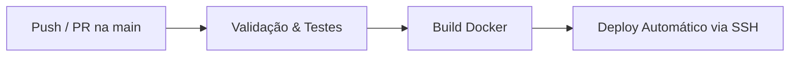

# 🌸 Portal da Mulher - Governo de Mato Grosso

[](https://github.com/abraaonazarioData/PortaldaMulher/actions/workflows/ci-cd.yml)
[](https://www.python.org/)
[](https://www.djangoproject.com/)
[](https://www.docker.com/)

Portal oficial de atendimento, informação, serviços públicos, legislação e proteção aos direitos das mulheres no Estado de Mato Grosso.

---

## 📌 Principais Funcionalidades

- **Central de Serviços e Políticas Públicas:** Catálogo unificado com acesso direto aos serviços do Estado (Delegacia Digital, Patrulha Maria da Penha, Meninas que Transformam).
- **Selo Empresa Amiga da Mulher:**
  - Consulta geoespacial e tabela interativa de estabelecimentos certificados.
  - Sincronização em tempo real com a **API Pública do Procon-MT** (`simplifica-dev.mt.gov.br`).
  - Visualização e download de **Certificados Oficiais em PDF**.
- **Painéis Interativos (BI) & Estatísticas:** Indicadores de violência e rede de apoio.
- **Rede de Proteção e Atendimento:** Busca inteligente de delegacias, núcleos de atendimento e pontos de apoio por município.
- **Materiais Educativos e Legislação:** Acesso a cartilhas, normas, decretos estaduais e orientações sobre a Lei Maria da Penha.
- **Chatbot Inteligente (Chat MT):** Assistente virtual para dúvidas e encaminhamento de emergências.

---

## 🏛️ Arquitetura do Projeto

```text
Portal-Mulher/
├── .github/
│   └── workflows/
│       └── ci-cd.yml               # Pipeline de CI/CD (Testes, Build Docker e Deploy)
├── django_portal_mulher/
│   ├── core/                       # App principal: models, views, admin e templates
│   │   ├── models.py               # EmpresaCertificadaSelo, PageContent, Tema, etc.
│   │   ├── views.py                # Lógica de integração Procon, views e APIs
│   │   └── templates/              # Telas personalizadas (servico_detalhe.html, etc.)
│   ├── portal_django/              # Configurações do projeto (settings.py, urls.py, wsgi.py)
│   ├── static/                     # Arquivos CSS, JavaScript, imagens e ícones
│   ├── media/                      # Uploads dinâmicos (notícias, banners, certificados)
│   └── manage.py                   # CLI do Django
├── Dockerfile                      # Definição do container de produção
├── docker-compose.yml              # Orquestração do serviço web na porta 80/8000
├── nginx_portal_mulher.conf        # Configuração de proxy reverso Nginx
└── README.md                       # Documentação técnica oficial
```

---

## 🚀 Como Executar Localmente

### 1. Pré-requisitos
- Python 3.12+
- Git

### 2. Passo a passo
```bash
# Clone o repositório
git clone https://github.com/abraaonazarioData/PortaldaMulher.git
cd PortaldaMulher/Portal-Mulher-main/django_portal_mulher

# Crie e ative o ambiente virtual
python -m venv .venv
# No Windows:
.venv\Scripts\activate
# No Linux/Mac:
source .venv/bin/activate

# Instale as dependências
pip install -r requirements.txt

# Execute as migrações
python manage.py migrate

# Inicie o servidor local
python manage.py runserver 0.0.0.0:8000
```
Acesse no seu navegador: `http://localhost:8000/`

---

## 🐳 Executando com Docker

Para rodar em ambiente isolado de produção com Docker Compose:

```bash
docker-compose up -d --build
```
O portal estará disponível em: `http://localhost/` (ou porta configurada no `docker-compose.yml`).

---

## 🔄 Pipeline de CI/CD (GitHub Actions)

O repositório possui uma pipeline automatizada configurada em `.github/workflows/ci-cd.yml`:



### Etapas da Automação:
1. **Validação & Testes:**
   - Setup do ambiente Python 3.12.
   - Instalação e verificação de dependências.
   - Execução do `django manage.py check`.
2. **Docker Build:**
   - Compilação e validação do `Dockerfile` multi-stage.
3. **Deploy Contínuo (CD):**
   - Conexão segura via SSH no servidor de hospedagem.
   - Execução do `git pull origin main`.
   - Reinicialização com `docker-compose up -d --build`.
   - Execução de `migrate` e `collectstatic`.

### Secrets do GitHub (Configuração Opcional para Deploy Automático):
No repositório do GitHub, acesse **Settings > Secrets and variables > Actions** e configure:
- `SERVER_HOST`: IP do servidor (ex: `158.69.171.5`)
- `SERVER_USER`: Usuário de acesso SSH (ex: `root`)
- `SERVER_SSH_KEY`: Chave privada SSH para acesso sem senha.
- `SERVER_PORT`: Porta SSH (padrão: `22`).

---

## 🛡️ Segurança e Boas Práticas

- **Proteção de Credenciais:** Arquivos de credenciais (`.env`, chaves locais e certificados) são ignorados pelo `.gitignore`.
- **Prevenção de Injeção & XSS:** Sanitização em renderizações dinâmicas e uso do ORM do Django.
- **Resiliência de API:** Fallback local para exibição dos dados das empresas certificadas caso a API externa do Procon fique temporariamente indisponível.

---

## 📄 Licença e Atribuição

Desenvolvido para o **Governo do Estado de Mato Grosso**. Todos os direitos reservados.
